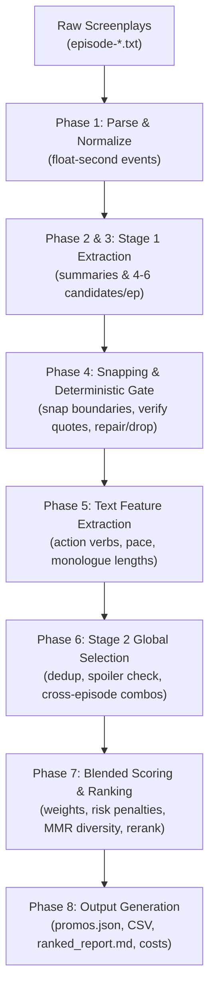

# Microdrama Promo Finder

> **Kuku Problem 1 Submission:** Intelligent extraction, validation, and multi-signal ranking of 20–60 second microdrama promotional trailers from timestamped screenplay episodes.

---

## Overview

The **Microdrama Promo Finder** is an AI-assisted editorial tool designed to scan entire microdrama screenplays (e.g., 50-episode seasons) and identify high-converting promotional clip candidates for platforms like TikTok, Instagram Reels, and YouTube Shorts.

Each candidate clip is evaluated against three core microdrama editorial requirements:
1. **The Hook (First 3s):** An instant pattern interrupt (a physical slap, shocking revelation, confrontation, or high-stakes dilemma) that prevents scrolling.
2. **The Cliffhanger (Ending):** Hard-cuts right before the question or conflict resolves, compelling viewers to click through or install the app.
3. **Standalone Comprehensibility:** Fully understandable to a cold viewer with zero prior context or character lore.

> [!NOTE]
> **Editorial Assistant Disclaimer:** This system operates strictly on **screenplay text** (no raw video or audio). Stage directions, kinetic pacing, and audio dynamics are inferred from text and are intended to accelerate human editorial curation, not replace it.

---

## Repository Structure

The repository has been restructured to be clean, modular, and immediately intuitive:

```
kuku_problem1/
├── README.md                      # Complete project guide and run instructions (this file)
├── config.yaml                    # Master pipeline configuration (models, thresholds, weights)
├── requirements.txt               # Core pipeline dependencies (google-genai, PyYAML, httpx, jsonschema)
├── requirements-dev.txt           # Testing and development dependencies (pytest, reportlab)
├── requirements-ui.txt            # Streamlit review UI dependencies
│
├── find_promos.py                 # Primary CLI entry point
├── app.py                         # Streamlit interactive human review web UI
├── make_pdf.py                    # ReportLab script that compiles the 2-page solution PDF
│
├── promo_finder/                  # Core Python Package
│   ├── __init__.py
│   ├── pipeline.py                # 8-phase pipeline orchestrator
│   ├── parse.py                   # Screenplay parser & float-second event normalizer
│   ├── llm.py                     # Swappable LLM provider interface (Gemini / OpenAI / Offline)
│   ├── stage1_candidates.py       # Phase 2 & 3: Per-episode summary & candidate extractor
│   ├── stage2_select.py           # Phase 6: Global deduplication, spoiler check, cross-episode combos
│   ├── validate.py                # Phase 4: Deterministic boundary snapping, quote & duration validation
│   ├── features.py                # Phase 5: Fast text heuristics (action verbs, dialog ratios, pace)
│   ├── rank.py                    # Phase 7: Blended scoring formula, MMR diversity & comparative rerank
│   ├── report.py                  # Phase 8: Output generators (JSON, CSV, Markdown, Logs)
│   ├── cost.py                    # Token usage and estimated USD spend tracking
│   └── prompts/                   # Structured prompt templates
│       ├── stage1.txt
│       ├── stage2.txt
│       └── rerank.txt
│
├── data/                          # Input screenplay data (gitignored confidential content)
│   ├── show -> shows/...          # Convenient symlink to the active show folder
│   └── shows/
│       └── I Married a Broken Soldier. He was a Duke/  # 50 episode screenplay text files
│
├── docs/                          # Submission deliverables and documentation
│   ├── SOLUTION_DOC.pdf           # 2-Page final candidate solution document PDF
│   └── SOLUTION_NOTES.md          # Architectural notes, formulas, design rationale & scaling analysis
│
├── eval/                          # Evaluation harness & benchmarks
│   ├── run_eval.py                # Evaluation runner (validity, segment IoU, top-N stability)
│   ├── gold_blind.json            # Blind human ground-truth benchmark
│   ├── failures.md                # Real failure mode analysis and case studies
│   └── editor_feedback.jsonl      # Editorial feedback log generated by the web UI
│
├── tests/                         # Automated unit and integration test suite
│   ├── test_parse.py              # Screenplay parsing and timestamp monotonicity
│   ├── test_validate.py           # Snapping, duration enforcement, quote verification
│   ├── test_features.py           # Heuristic feature computation
│   ├── test_rank.py               # Scoring formula, penalty deduction, diversity sort
│   └── test_llm_cache.py          # SHA-256 disk caching and retry behavior
│
├── outputs/                       # Generated run outputs (gitignored)
└── cache/                         # Disk-persisted LLM call cache (gitignored)
```

---

## Quick Start & Installation

### 1. Prerequisites
- **Python 3.10+** (developed and tested with Python 3.10)
- Operating System: macOS, Linux, or Windows (WSL)

### 2. Environment Setup

Clone or enter the project directory and create a virtual environment:

```bash
# Navigate to the repository root
cd /path/to/kuku_problem1

# Create and activate a virtual environment
python3 -m venv .venv
source .venv/bin/activate
```

### 3. Install Dependencies

Install the core dependencies:

```bash
pip install -r requirements.txt
```

If you plan to run automated tests or generate the solution PDF:
```bash
pip install -r requirements-dev.txt
```

If you want to run the interactive Streamlit review UI:
```bash
pip install -r requirements-ui.txt
```

### 4. API Key Configuration

The pipeline supports Google Gemini (default) and OpenAI-compatible endpoints. Set your environment variable:

```bash
# For Google Gemini (default: gemini-3.8-flash)
export GEMINI_API_KEY="your-gemini-api-key"

# OR for OpenAI-compatible endpoints
export OPENAI_API_KEY="your-openai-api-key"
```

*(Note: No API key is required if you run in `--offline` mode).*

---

## How to Run the Project

### Mode 1: Offline Deterministic Smoke Test (No API Key Required)

Run the deterministic local baseline to verify screenplay parsing, timestamp snapping, constraint validation, heuristic scoring, MMR diversity ranking, and output reporting in seconds:

```bash
python find_promos.py data/show --offline
```

You can also pass any arbitrary folder containing `episode-*.txt` files:
```bash
python find_promos.py "/path/to/any/show/folder" --offline
```

### Mode 2: Full LLM Extraction & Ranking Pipeline

Run the production pipeline using Google Gemini (or configured provider):

```bash
# Run on the included 50-episode show
python find_promos.py data/show

# Run with rolling previous-episode context passed to Stage 1
python find_promos.py data/show --context

# Run with a custom run ID and specific output directory
python find_promos.py data/show --run-id my_show_run --output-dir outputs
```

### Mode 3: Interactive Streamlit Review UI

Launch the editorial review web application:

```bash
streamlit run app.py
```

**Features of the UI:**
- Upload a ZIP archive or multiple `episode-*.txt` screenplay files.
- Select provider (`gemini` or `openai_compatible`), override models, or toggle the offline baseline.
- View ranked top-10 promos with visual badges for hooks, cliffhangers, and content flags.
- **Human Review Panel:** Editors can Approve, Reject, or Adjust timestamps, and log qualitative notes directly to `eval/editor_feedback.jsonl`.

### Mode 4: Evaluation & Quality Benchmarking

Evaluate generated promo runs against human-authored blind ground truth (`eval/gold_blind.json`):

```bash
# Evaluate compliance and IoU precision/recall against the gold set
python eval/run_eval.py outputs/baseline_50eps --gold eval/gold_blind.json

# Evaluate stability between two different model runs (Top-20 Jaccard similarity)
python eval/run_eval.py outputs/baseline_50eps --second-output outputs/demo_run
```

### Mode 5: Automated Test Suite

Run the unit and integration tests across parser, validator, heuristics, ranking, and caching:

```bash
python -m pytest -q
```

All 9 test suites should pass in ~1 second.

### Mode 7: Generate Solution Document PDF

Recompile the 2-page candidate solution brief directly from code:

```bash
python make_pdf.py
```
Outputs: `docs/SOLUTION_DOC.pdf` and synchronizes `SOLUTION_DOC.pdf` at the root.

---

## Output Artifacts & Submission Deliverables

Per the assignment brief, unedited outputs from running on the full 50-episode input pack are provided in the **`raw_outputs/`** directory (and mirrored in `outputs/full_run_50eps/`):

| Artifact | Format | Description |
|---|---|---|
| `promos.json` | JSON | Complete candidate dataset in deterministic rank order with episode IDs, float-second timestamps, quote snippets, component scores, and flags. |
| `promos.csv` | CSV | Flat table view of all ranked candidates for quick spreadsheet import and data science analysis. |
| `ranked_report.md` | Markdown | Executive summary detailing the Top promos, their 3s hook, unresolved cliffhanger, rationale, and specific advice on which to post first. |
| `validation_report.json` | JSON | Funnel accounting metrics: raw candidates proposed, valid on first pass, repaired, dropped, and reason distributions. |
| `stage2_report.json` | JSON | Stage 2 audit log showing duplicate eliminations, spoiler risk flags, and cross-episode combo candidate evaluations. |
| `cost_report.json` | JSON | Aggregate token count (prompt + candidate) and estimated USD cost based on published model pricing. |
| `parse_report.json` | JSON | Structural audit of the input screenplay: total episodes, event counts, dialogue vs action ratios, and parsing anomalies. |
| `run_log.txt` | Text | Complete, timestamped console execution trace. |

---

## System Architecture

### What Goes to Deterministic Code vs. the LLM

To guarantee rock-solid reliability and eliminate hallucinations, responsibilities are strictly separated:

| Deterministic Code (Zero Hallucination) | LLM Judgment (Semantic Understanding) |
|---|---|
| Screenplay parsing into float-second events | Spotting emotionally gripping 3s hooks |
| Event boundary snapping and quote verification | Identifying genuine, unresolved cliffhangers |
| Duration compliance ($20\text{s} \le \Delta t \le 60\text{s}$) | Assessing cold-viewer standalone clarity |
| Non-overlapping segment ordering ($\le 3$ segments) | Summarizing episodes and proposing cross-episode combos |
| Heuristic feature extraction (pace, action verbs, dialogue) | Generating editorial rationale ("why this works") |
| Multi-signal scoring formula, penalties, & MMR diversity | Comparative reranking of the top 20 candidates |
| SHA-256 disk caching, backoff retries, & cost tracking | |

### The 8-Phase Pipeline



1. **Phase 1 (Parse):** Reads screenplay text, extracts character dialogue, stage directions, and parentheticals, normalising time codes (`MM:SS.ss`) into float seconds.
2. **Phase 2 & 3 (Stage 1 Extraction):** Summarizes each episode and extracts 4–6 high-potential promo windows based on dramatic intensity.
3. **Phase 4 (Validation Gate):** Snaps rough LLM timestamps to exact source event boundaries, validates exact quote substrings, enforces duration boundaries ($20\text{s} \le t \le 60\text{s}$), and attempts a structured single-turn JSON repair for malformed candidates before dropping them.
4. **Phase 5 (Heuristic Features):** Computes objective signals from script text (density of physical action verbs, dialogue turnover speed, and ending punctuation).
5. **Phase 6 (Stage 2 Selection):** Removes near-duplicate windows across adjacent episodes, screens for major spoilers, and explores multi-segment cross-episode thematic combos.
6. **Phase 7 (Ranking & Diversity):** Calculates a weighted blended score, applies explicit penalties (for spoiler risk, heavy context dependency, or borderline durations), invokes a comparative reranker on the top-20 candidates, and applies MMR-style time-overlap suppression ($\le 5\text{s}$ overlap) with a cap of at most 2 promos per episode in the Top 10.
7. **Phase 8 (Reporting):** Serializes all audit logs, reports, JSONs, and CSVs.

---

## Configuration & Model Swapping

All parameters are centrally managed in `config.yaml`:

```yaml
# LLM Provider & Models
provider: gemini                    # 'gemini' or 'openai_compatible'
gemini:
  api_key_env: GEMINI_API_KEY
  stage1_model: gemini-3.8-flash
  stage2_model: gemini-3.8-flash
  rerank_model: gemini-3.8-flash

openai_compatible:
  api_key_env: OPENAI_API_KEY
  base_url: https://api.openai.com/v1
  stage1_model: gpt-4o-mini
  stage2_model: gpt-4o
  rerank_model: gpt-4o

# Constraints
promo:
  min_duration_s: 20
  max_duration_s: 60
  duration_tolerance_s: 3
  max_segments: 3
  hook_window_s: 3

# Scoring Weights
scoring:
  w_hook: 0.25
  w_cliffhanger: 0.30
  w_standalone: 0.20
  w_pace: 0.10
  w_heuristics: 0.15

# Penalties
  penalty_spoiler_high: 0.30
  penalty_needs_context: 0.20
  penalty_visual_risk_high: 0.15
```

---

## Documentation & Deliverables

- **[docs/SOLUTION_DOC.pdf](docs/SOLUTION_DOC.pdf):** 2-page executive solution brief containing problem scoping, assumptions, pipeline diagram, scoring formula, evaluation metrics, failure analysis, scaling costs, and validation methodology.
- **[docs/SOLUTION_NOTES.md](docs/SOLUTION_NOTES.md):** Detailed architectural write-up, mathematical formulas, cost breakdown tables, and interview discussion topics.
- **[eval/failures.md](eval/failures.md):** Qualitative study of real failure modes encountered on raw screenplay data (e.g., quiet dialogue outranking visual action, lore dependencies, borderline durations).
- **[raw_outputs/](raw_outputs/):** Full unedited 50-episode run outputs (JSON, CSV, Markdown, validation reports).

